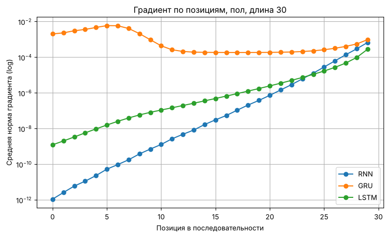
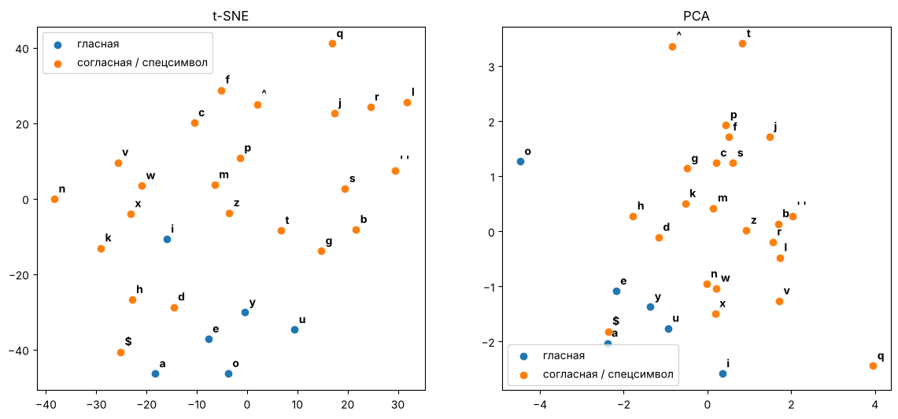

# RNN, GRU и LSTM с нуля: генерация имён и пол по имени

Символьная языковая модель на 6782 английских именах. Ячейки RNN, GRU и LSTM написаны вручную на PyTorch (без `nn.RNN` / `nn.GRU` / `nn.LSTM`). На них решаю две задачи: генерирую новые имена по одной букве и определяю пол по имени. Отдельно смотрю на затухание градиентов и сравниваю сети с готовыми слоями torch и с бустингом.

```
t=0.3: alexa, mardin, charlen, marila, ellie, lanie, lucie
mar:   marina, mariane, marette, marice
```

## Данные

`data/babynames-clean.csv`: имя и пол, 3437 мальчиков и 3345 девочек, длина от 2 до 11 букв. Каждое имя встречается один раз, и часть женских имён (Mary, Anna, Emma) отмечена как boy, так что в разметке есть шум. Разбиение 80/10/10 со стратификацией и фиксированным `random_state`, одно и то же для всех моделей.

## Что сделано

- Свои ячейки RNN, GRU, LSTM и модель с двумя головами: следующая буква и пол.
- Генерация имён с температурой и заданным началом.
- Перплексия двумя способами (по вероятностям и как exp(cross entropy)), сравнение со случайной моделью и моделью частот букв.
- Классификация пола с BCE и NLL.
- Эксперимент с затуханием градиентов: удлиняю последовательности пробелами и смотрю норму градиента по каждой позиции.
- Multitask: одна GRU учится и генерировать, и определять пол.
- Эмбеддинги букв и имён через t-SNE и PCA.
- Бонус: подбор гиперпараметров optuna, сравнение с `nn.RNN` / `nn.GRU` / `nn.LSTM`, двунаправленная GRU, градиентный бустинг на буквенных n-граммах.

## Результаты

Генерация (перплексия на valid, меньше лучше):

| Модель | PPL |
|---|---|
| Все буквы равновероятны | 29.0 |
| Частоты букв | 17.0 |
| RNN | 8.2 |
| GRU | 7.9 |
| LSTM | 8.0 |

Пол по имени (ROC AUC на test):

| Модель | ROC AUC |
|---|---|
| RNN / GRU / LSTM, свои ячейки | 0.875 / 0.894 / 0.894 |
| GRU multitask (буквы + пол) | 0.887 |
| GRU, параметры от optuna | 0.907 |
| Двунаправленная GRU, 2 слоя (torch) | 0.907 |
| Градиентный бустинг на n-граммах | **0.923** |

Затухание градиентов. После имени добавляю пробелы до длины 30, пол предсказывается в самом конце:



| Длина | RNN | LSTM | GRU |
|---|---|---|---|
| 13 | 0.899 | 0.904 | 0.916 |
| 30 | 0.509 | 0.667 | 0.910 |
| 50 | 0.500 | 0.518 | 0.910 |

Главное:
- Все три ячейки генерируют правдоподобные имена, перплексия около 8 против 29 у случайной модели.
- У обычной RNN градиент от конца к началу падает в 10^8 раз, и на длинных последовательностях она перестаёт понимать пол (AUC 0.5). GRU держится на 0.91, LSTM помогает forget bias = 1 (0.88 на длине 30).
- Свои ячейки по качеству не отличаются от готовых слоёв torch, но медленнее.
- Для пола главное это окончание имени: у бустинга самый важный признак `a$`, и он обходит все сети.



## Структура

- `names_rnn.ipynb`: весь анализ и эксперименты
- `rnn.py`: ячейки RNN/GRU/LSTM, модель, обучение, генерация, перплексия, сбор градиентов
- `data/babynames-clean.csv`: датасет
- `models/`: сюда ноутбук сохраняет модель и предсказания для теста

## Запуск

```bash
pip install -r requirements.txt
jupyter notebook names_rnn.ipynb
```

Весь ноутбук считается на CPU примерно за 15 минут.
